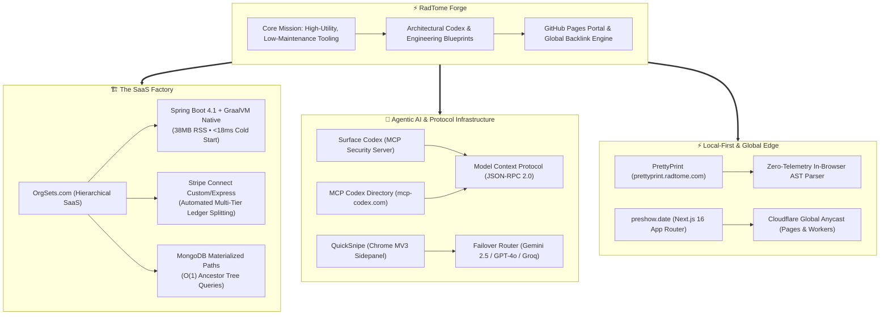

<p align="center">
  <a href="https://radtome.com">
    
  </a>
</p>

<p align="center">
  <a href="https://radtome.com"></a>
  <a href="https://radtome.github.io/"></a>
  <a href="https://orgsets.com"></a>
  <a href="https://chromewebstore.google.com/detail/quicksnipe-1-click-listin/aignalgmmlmnmofabamcdngdopabgkaa"></a>
  <a href="https://github.com/RadTome/surface-codex"></a>
</p>

<p align="center">
  
  
  
  
  
  
  
</p>

<p align="center">
  <a href="#-shipped-production-systems--live-artifacts"><b>🚀 Shipped Systems</b></a> •
  <a href="#%EF%B8%8F-ecosystem-architecture--topology"><b>🗺️ Ecosystem Topology</b></a> •
  <a href="#%EF%B8%8F-the-production-tech-matrix"><b>🛠️ Tech Matrix</b></a> •
  <a href="#-architectural-codex--engineering-whitepapers"><b>📚 Architectural Codex</b></a> •
  <a href="#-the-radtome-philosophy"><b>🔮 Philosophy</b></a> •
  <a href="https://radtome.github.io/"><b>⚡ Live Portal</b></a>
</p>

---

## Welcome to the Tome. ⚡📖

**RadTome** is an independent software forge engineering **high-utility developer tooling**, **zero-latency enterprise microservices**, and **the SaaS factory of the future**.

We engineer the hardened, mission-critical foundation—**sub-20ms GraalVM AOT native compilation**, **hierarchical multi-tenancy**, **automated double-entry ledger routing**, **zero-telemetry client AST computation**, and **Model Context Protocol (MCP) agent infrastructure**—so developers and businesses can ship radical products.

> 🌐 **Interactive Portal**: Explore real-time telemetry, live project filters, and backlink codex on the **[RadTome GitHub Pages Portal](https://radtome.github.io/)** or the primary forge at **[radtome.com](https://radtome.com)**.

---

## 🚀 Shipped Production Systems & Live Artifacts

RadTome authors and maintains production systems across enterprise cloud backends, edge runtimes, browser extensions, and autonomous AI protocol networks:

### 1. [OrgSets.com](https://orgsets.com) — Enterprise Hierarchical SaaS Platform
> **Flagship Multi-Tenant Governance, Voting & Automated Ledger Platform**
* **Stack:** Java 25 • Spring Boot 4.1.1 • GraalVM AOT Native Images • React 19 • MongoDB Materialized Paths • Stripe Connect
* **Capabilities:** Full-stack multi-tenant platform for hierarchical organizational management. Features sub-20ms cold starts, democratic governance voting with cryptographic ballots, automated multi-tier Stripe Connect fee splitting, and immutable compliance auditing.
* **Direct Links:** [Visit OrgSets.com](https://orgsets.com) • [Read Architecture Whitepaper](https://radtome.com/articles/graalvm-spring-boot-3-native)

### 2. [QuickSnipe](https://chromewebstore.google.com/detail/quicksnipe-1-click-listin/aignalgmmlmnmofabamcdngdopabgkaa) — AI Listing Studio & Competitor Velocity Sniper
> **High-Performance Chrome Manifest V3 Extension for Multi-Channel Resellers**
* **Stack:** Chrome Manifest V3 • SidePanel API • Multi-LLM Failover Router (Gemini 2.5 / GPT-4o / Groq) • ExtensionPay
* **Capabilities:** 1-click direct listing editor form autofill across **7 platforms** (Etsy, Amazon, eBay, Shopify, Poshmark, Depop, Mercari). Includes live profit & margin fee calculators, Amazon 249-byte backend term validator with UTF-8 byte meter, review objection miner, and competitor keyword gap analysis.
* **Direct Links:** [Chrome Web Store](https://chromewebstore.google.com/detail/quicksnipe-1-click-listin/aignalgmmlmnmofabamcdngdopabgkaa) • [GitHub Support Repo](https://github.com/RadTome/QuickSnipe-support) • [Extension Guide](https://radtome.com/articles/manifest-v3-chrome-extension-architecture)

### 3. [Surface Codex](https://github.com/RadTome/surface-codex) — Domain Attack Surface Reconnaissance MCP Server
> **High-Performance Security Intelligence MCP Server for Autonomous Coding Agents**
* **Stack:** Model Context Protocol (MCP) • Spring AI • Java 25 • GraalVM Native Image • RDAP / Certificate Transparency
* **Capabilities:** Empowers AI agents (Claude Desktop, Cursor, Windsurf, Cline) with 9 autonomous tools to scan domain security postures, discover subdomains via Certificate Transparency logs, detect look-alike typosquatting brand risks, audit SSL/TLS chains, evaluate HTTP security headers, and correlate software with live CVEs.
* **Direct Links:** [GitHub Repository](https://github.com/RadTome/surface-codex) • [MCP Protocol Specs](https://mcp-codex.com)

### 4. [MCP Codex](https://mcp-codex.com) — The Definitive Model Context Protocol Directory
> **Curated Catalog & Implementation Blueprints for Anthropic MCP Servers**
* **Stack:** Model Context Protocol (MCP) • Cloudflare Pages Edge • JSON-RPC 2.0 • Agent Tooling Registry
* **Capabilities:** The premier directory for MCP servers connecting AI agents directly to production databases, enterprise APIs, cloud runtimes, and local developer environments.
* **Direct Links:** [Visit MCP-Codex.com](https://mcp-codex.com) • [GitHub Support Repo](https://github.com/RadTome/mcp-codex-support) • [MCP Architecture Deep Dive](https://radtome.com/articles/model-context-protocol-enterprise-guide)

### 5. [PrettyPrint](https://prettyprint.radtome.com) — Zero-Telemetry Developer Utility
> **100% In-Browser AST Parser for Instant Recursive JSON & XML Formatting**
* **Stack:** Client-Side AST Engine • Zero External Telemetry • React 19 • Cloudflare Edge CDN
* **Capabilities:** High-speed developer formatting engine that processes massive, deeply nested payloads in milliseconds entirely in memory. Guarantees 100% data privacy—sensitive tokens, enterprise credentials, and customer records never leave the browser.
* **Direct Links:** [Launch PrettyPrint](https://prettyprint.radtome.com) • [Why Local-First DevTools Matter](https://radtome.com/articles/local-first-data-processing-prettyprint)

### 6. [preshow.date](https://preshow.date) — Modern Historical Event & Culture Engine
> **Zero-PII Historical Pre-Show Explorer on Cloudflare Edge**
* **Stack:** Next.js 16 (App Router) • React 19 • Tailwind CSS 4 • Cloudflare Workers (`@opennextjs/cloudflare`)
* **Capabilities:** Computes cultural and historical pre-shows 9 months prior to any birthdate with zero telemetry. Birthdates never leave the client; dynamic OpenGraph social cards are generated on the fly via edge workers.
* **Direct Links:** [Visit preshow.date](https://preshow.date)

---

### 📊 System Classification & Telemetry Matrix

| System | Role | Runtime Environment | Core Architecture | Live Status |
| :--- | :--- | :--- | :--- | :--- |
| **OrgSets.com** | Enterprise SaaS | GraalVM Native / Cloud Containers | Java 25, Spring Boot 4.1.1, React 19, MongoDB, Stripe Connect | [Active Production](https://orgsets.com) |
| **QuickSnipe** | Browser Extension | Chrome Manifest V3 SidePanel | Gemini 2.5 / GPT-4o / Groq Failover, 7-Platform Scraper | [v1.4.2 Shipped](https://chromewebstore.google.com/detail/quicksnipe-1-click-listin/aignalgmmlmnmofabamcdngdopabgkaa) |
| **Surface Codex** | Security MCP Server | Native Binary / Stdio & SSE | Spring AI, Java 25 GraalVM Native, RDAP, CT Logs, CVEs | [Open Source](https://github.com/RadTome/surface-codex) |
| **MCP Codex** | Protocol Directory | Cloudflare Global Anycast Edge | JSON-RPC 2.0, MCP Specification, Edge Static Cache | [Active Production](https://mcp-codex.com) |
| **PrettyPrint** | Local-First DevTool | 100% In-Browser Memory (Client AST) | React 19, Zero Telemetry, Recursive Formatter | [Active Production](https://prettyprint.radtome.com) |
| **preshow.date** | Web & Edge App | Cloudflare Workers (`workerd`) | Next.js 16, React 19, Tailwind 4, Edge SSR OG Cards | [Active Production](https://preshow.date) |

---

## 🗺️ Ecosystem Architecture & Topology



---

## 🛠️ The Production Tech Matrix

| Domain | Core Stack | Architectural Role | Production Benchmark |
| :--- | :--- | :--- | :--- |
| **Backend & Native Binaries** | **Java 25**, Spring Boot 4.1.1, GraalVM Native Image AOT | Zero-warmup microservices, Linux ELF native compilation, virtual threads & modern generational ZGC | Sub-20ms cold boot, <40MB resident set size (RSS) |
| **Agentic AI & Protocols** | **Model Context Protocol (MCP)**, Spring AI, Gemini 2.5, OpenAI GPT-4o, Groq LPU | Autonomous agent tool registry, security reconnaissance, competitor velocity analysis | Deterministic JSON-RPC 2.0 tool execution with sub-second failover |
| **Frontend & Modern Web** | **React 19**, Next.js 16, Vite, Tailwind CSS 4, Vanilla CSS | Server-rendered edge apps, zero layout shifts, high-density telemetry dashboards | 100/100 Lighthouse Performance, zero hydration mismatch |
| **Data & Storage** | **MongoDB** (Materialized Paths), Redis, Cloudflare KV & D1 | Hierarchical tree structures, distributed atomic locks, session caching | O(1) recursive permission checks, sub-millisecond lock acquisition |
| **Fintech & Billing** | **Stripe Connect** Custom/Express, Transfer Groups | Double-entry ledgers, automated multi-party dues splitting, idempotent webhooks | Zero duplicate charges, automated refund ledger rollback |
| **Browser Runtimes** | **Chrome Manifest V3**, SidePanel API, `chrome.storage.session` | Background service workers, persistent sidepanel workspaces, extension security | Instant DOM inspection across 7 e-commerce portals |
| **Edge & Infrastructure** | **Cloudflare Workers & Pages**, GitHub Actions, Docker multi-stage | Global Anycast edge compute, automated native compilation CI/CD pipelines | Sub-30ms global edge response time |

---

## 📚 Architectural Codex & Engineering Whitepapers

RadTome publishes in-depth engineering analyses, performance benchmarks, and architectural blueprints authored from our live production codebases. Read the full volumes at **[radtome.com/articles](https://radtome.com/articles)**:

```
  ┌────────────────────────────────────────────────────────────────────────────────────────┐
  │  RADTOME ARCHITECTURAL CODEX // PRODUCTION CASE STUDIES & SPECIFICATIONS               │
  └────────────────────────────────────────────────────────────────────────────────────────┘
```

* ☕ **[High-Throughput Microservices: Java 25 & Spring Boot 4.1 GraalVM Native Images](https://radtome.com/articles/graalvm-spring-boot-3-native)**  
  *How Ahead-of-Time (AOT) compilation eliminates the JVM warmup penalty, slashes cloud container memory from 512MB to under 40MB, and achieves sub-20ms instant cold starts.*
* 🧩 **[Building Chrome Extensions Under Manifest V3: Service Workers & SidePanel API](https://radtome.com/articles/manifest-v3-chrome-extension-architecture)**  
  *Surviving aggressive service worker teardowns, structuring cross-context message pipelines, and implementing multi-LLM fallback routing with `chrome.storage.session`.*
* 🛡️ **[Model Context Protocol (MCP) in Production: Bridging Autonomous Agents to Enterprise APIs](https://radtome.com/articles/model-context-protocol-enterprise-guide)**  
  *JSON-RPC 2.0 message flows, stdio vs. SSE transports, security sandboxing, and registering dynamic tools for Claude Desktop, Cursor, and Windsurf.*
* 🔒 **[Local-First Engineering: Why In-Browser JSON & Recursive XML Formatting Matters](https://radtome.com/articles/local-first-data-processing-prettyprint)**  
  *Eliminating compliance and data-leakage risks in developer tooling by running recursive AST parsing algorithms entirely client-side with zero external telemetry.*
* ⚡ **[Building Ultra-Fast Edge Web Apps with React 19, Vite, and Cloudflare Pages](https://radtome.com/articles/react-19-cloudflare-edge-performance)**  
  *Headless browser prerendering, immutable asset hashing, edge caching headers, and eliminating blocking waterfall requests across global CDN nodes.*
* 🏢 **[Multi-Tenant SaaS Architecture: Designing Hierarchical Node Trees in MongoDB & Redis](https://radtome.com/articles/multi-tenant-saas-hierarchical-nodes)**  
  *Modeling arbitrary deep chapter hierarchies using the Materialized Path pattern for O(1) query indexing and delegated enterprise permissions.*
* 💳 **[Building Automated Fee-Splitting & Compliance Ledgers with Stripe Connect](https://radtome.com/articles/stripe-connect-automated-ledger-splitting)**  
  *Multi-tier payment distribution, transfer groups, webhook idempotency, and architecting immutable double-entry ledger bookkeeping.*

---

## 🔮 The RadTome Philosophy

```
  RADICAL KNOWLEDGE  •  OPINIONATED ARCHITECTURE  •  ENGINEERED TO ENDURE
```

**RadTome** exists at the precise intersection of a **Rad Tome** (an authoritative, weighty manual of engineering power) and software that is simply **Rad To Me** (built with conviction, precision, and unapologetic craftsmanship).

* **Rad** — from *Radical*. Bold. Unconventional. Refusing to settle for bloated, disposable software patterns.
* **Tome** — an enduring, scholarly volume. Knowledge distilled into permanent, verifiable systems.
* **Rad To Me** — highly opinionated engineering. Built for developers who appreciate elegance under the hood.

### 🏛️ The Four Tenets of the Forge

1. **Zero Telemetry Where It Matters Most:** Developer tools dealing with code, credentials, or customer data should execute client-side whenever possible. Zero telemetry isn't a feature—it's an architectural guarantee.
2. **Cold-Start Zero:** We reject heavy 30-second JVM warmup cycles and swollen container images. Ahead-of-Time native compilation (GraalVM) yields microsecond cold boots and sub-40MB RAM footprints.
3. **Protocol-First AI Integration:** We don't build brittle API wrappers. We engineer standardized Model Context Protocol (MCP) servers using strict JSON-RPC 2.0 schemas so any LLM agent can securely interact with enterprise tooling.
4. **Hardened Foundations First:** Build the "boring" stuff—multi-tenancy, immutable ledgers, idempotent webhooks, and AOT compilation—once and build it right, so shipping the "rad" product is effortless.

> *"We think you're gonna like it here."*

---

## 🌐 RadTome Network & Global Codex

<p align="center">
  <a href="https://radtome.com"><b>Official Web Forge</b></a> •
  <a href="https://radtome.github.io/"><b>Interactive Portal</b></a> •
  <a href="https://orgsets.com"><b>OrgSets SaaS</b></a> •
  <a href="https://mcp-codex.com"><b>MCP Codex</b></a> •
  <a href="https://prettyprint.radtome.com"><b>PrettyPrint</b></a> •
  <a href="https://radtome.com/articles"><b>Architectural Articles</b></a> •
  <a href="https://radtome.com/about"><b>About & Leadership</b></a>
</p>

<p align="center">
  <sub><b>RadTome Organization</b> • Memphis, TN 🛠️ • Systems Architecture & Editorial Leadership by Rad Tome</sub>
</p>
